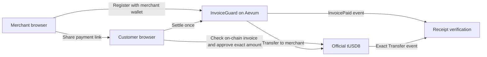

# InvoiceGuard

[Open public demo](https://kaivenn52.github.io/invoiceguard/) · [Validated deployment](https://github.com/KaiVenn52/invoiceguard/actions/runs/44125293861)

Every invoice. One exact payment. A noncustodial stablecoin invoice workspace for Aevum testnet: the merchant registers an invoice, shares it as JSON, and the customer pays through a contract that settles only once.

## Run and use

`npm run dev` listens on http://127.0.0.1:5182. Configure a deployed InvoiceGuard address. The app verifies its full runtime bytecode, including the official token immutable, before wallet actions. Arbitrary contracts and proxies are rejected.

1. Create an invoice draft using the recipient wallet address, exact tUSD8 amount and reference.
2. Connect the recipient EVM wallet on Aevum testnet (44005), then register it.
3. Export the invoice JSON to the customer. They import it in another browser and use the invoice-bound settlement address. Imported claims of payment are discarded.
4. Before payment, the app checks on-chain recipient, amount, expiry and reference hash. The wallet first approves the exact invoice amount of official tUSD8, then calls settlement. If settlement is rejected after approval, an allowance may remain; revoke it in the wallet before abandoning the payment.
5. Verify the settlement transaction. Both the matching InvoicePaid event and exact official-token Transfer must exist in a successful transaction to the bound contract. Export reconciliation evidence. A receipt is a fixed-node observation, not an independent consensus proof.

Official tUSD8: `0x456569838f1d43009A91ebA4263147Afd7233483`, 6 decimals. RPC: `https://rpc-test.qday.info`. Browser wallet required. No signing keys are stored in this project. Sample rows are explicitly labelled and cannot be paid or verified. Local drafts survive reload; payment status must be verified again rather than trusting browser storage.

## Contract build and deployment

The sibling `../invoiceguard-contracts` contains Solidity sources and adversarial settlement tests. Run `npm ci`, `npm test`, `npm run build`, then `npm run sync-artifact` there. The last command updates this app's pinned ABI and bytecode. Rebuild the frontend after changing the contract.

The demonstrated contract is deployed on Aevum at `0x66e9af874146a197eaf4b3ef7e0750c827c5d814`. To deploy a fresh instance, use the supplied `ignition/modules/InvoiceGuard.ts` module with `npx hardhat ignition deploy ignition/modules/InvoiceGuard.ts --network aevum` and a dedicated testnet account.

## Safety properties

The contract rejects duplicate IDs, replayed payments, expired/cancelled invoices, unauthorized bound payers, self-payments, false-returning transfers and short/taxed token transfers. Creation is bound to the recipient's sender address; custody remains with buyer and merchant. Customer names/reference text remain in exported files and browser storage; only their hash is written on chain.

## Live testnet evidence

The demo merchant issued AEVUM-DEMO from its own wallet. A separate buyer approved exactly 125001 base units and paid 0.125001 tUSD8. The public app recovered the transaction by invoice and passed all five receipt checks. [Deployment](https://explorer-test.qday.info/tx/0xa1050a331026d096306516f2d574873f92222db5ea70f14fd5deec50f1fe7f63) · [Invoice creation](https://explorer-test.qday.info/tx/0xce2d3f148d61249a6ce398c356c87a126139ffacaa6a36808263ce1b2863a415) · [Exact approval](https://explorer-test.qday.info/tx/0xef3c9869570f2d03dcd5f11b3d7edf00b1ed0ae8571ede05351284a863637af7) · [Successful payment](https://explorer-test.qday.info/tx/0xf915b6fe0fb59aba2543385c3a785bca723f3de994388f1dec5b1493eebea3e8).

1. [Open the demo invoice](https://kaivenn52.github.io/invoiceguard/#invoice=%7B%22version%22%3A1%2C%22chainId%22%3A44005%2C%22invoice%22%3A%7B%22key%22%3A%22d4efa4e7-76d7-459e-80a3-e5f174c0baee%22%2C%22reference%22%3A%22AEVUM-DEMO%22%2C%22customer%22%3A%22Testnet%20demonstration%22%2C%22recipient%22%3A%220x37d60fCEBEa7A69175e235eb0aAD0b6AbE51eC3D%22%2C%22amount%22%3A%220.125001%22%2C%22expiresAt%22%3A1796313080%2C%22nonce%22%3A%220x940fc9fca22af86b75e229157eb592d5b6e1f5867d3512aa0e4492753d939f7b%22%2C%22id%22%3A%220xf932513f0170505baf4b3e1064bdc36c13a141a69a7ab1aaf34ab40b624fce79%22%2C%22contract%22%3A%220x66e9af874146a197eaf4b3ef7e0750c827c5d814%22%7D%7D) or import [the demo invoice JSON](evidence/aevum-demo-invoice.json) in the app.
2. Paste `0xf915b6fe0fb59aba2543385c3a785bca723f3de994388f1dec5b1493eebea3e8` into Transaction hash and choose **Verify receipt**. A recent payment can also be found without the hash.
3. Compare the checks with [the exported chain evidence](evidence/aevum-settlement.json).

The recorded timestamps and receipt are fixed-node observations. Local automated tests and tutorials use fixtures separately. No competition submission is claimed. Testnet assets have no monetary value.

Run `npm ci`, `npm test`, `npm run build`, then `npm start`. Node 24 is supported. The production server serves the build and proxies only the fixed official upstream. Set `PORT` for hosting; terminate TLS at your hosting platform. A static-only host cannot serve the RPC proxy. A Dockerfile is included, but the container has not yet been built or deployed. No secrets are needed by the frontend or proxy.

## AI assistance

See AI_USAGE.md. MIT licensed. This prototype has not undergone an independent security audit.

Source repositories: [frontend](https://github.com/KaiVenn52/invoiceguard), [contracts](https://github.com/KaiVenn52/invoiceguard-contracts). Clone both into the same parent directory for artifact synchronization.

The GitHub Pages workflow builds with `VITE_DIRECT_RPC=true` to call only the official Aevum RPC directly. Its CORS preflight allows the public origin and content-type header. Default local/Node builds continue to use the fixed server proxy.

### Deploy from the browser

Open **Set up a settlement contract** in the public app. Connect an EVM wallet on Aevum testnet, fund it with test tQDAY and choose **Deploy on Aevum testnet**. The app uses the compiled creation bytecode and official tUSD8, then checks the returned contract's runtime. If confirmation times out, **Load deployment address** resumes from the recorded transaction. After registering an invoice, **Create payment link** generates a link which automatically imports its terms into the recipient's browser. The link contains the invoice reference and customer name.

### Chain preflight and architecture

Run `npm run check:aevum` to check the live testnet ID, official token decimals, and the exact runtime produced by the contract constructor at a named block. The script uses `eth_call` without a wallet or gas. Its output records a deployment simulation. A broadcast deployment and successful invoice settlement still produce their own transaction receipts.

### Recover a payment after closing the page

Open the registered invoice again. Leave the transaction hash empty and choose **Find payment on chain**. InvoiceGuard checks that the reviewed contract marks the invoice paid, then searches up to 10,000 recent blocks for its indexed payment event. It still verifies the successful receipt and exact official-token transfer. Supply the transaction hash directly for older payments.

### Live Aevum testnet rehearsal

With Node 24 use `node scripts/settle-aevum.mjs check <testnet-key-file>` to check account balances. The local key file must contain `merchant` and `buyer` private keys from two disposable testnet accounts. Keep that file outside the repository. The script fixes the chain to official QDay Aevum (44005) and checks the official token.

With faucet funds, use `node scripts/settle-aevum.mjs run <testnet-key-file>` to deploy InvoiceGuard, register a demo invoice, approve the exact 0.125001 tUSD8 amount and settle from the buyer account. It funds the buyer with testnet assets if needed. It persists each transaction hash and writes an evidence JSON with explorer links only after all receipt checks pass. If a broadcast outcome was ambiguous, pause and recover the transaction hash from the account history before resuming the journal.
